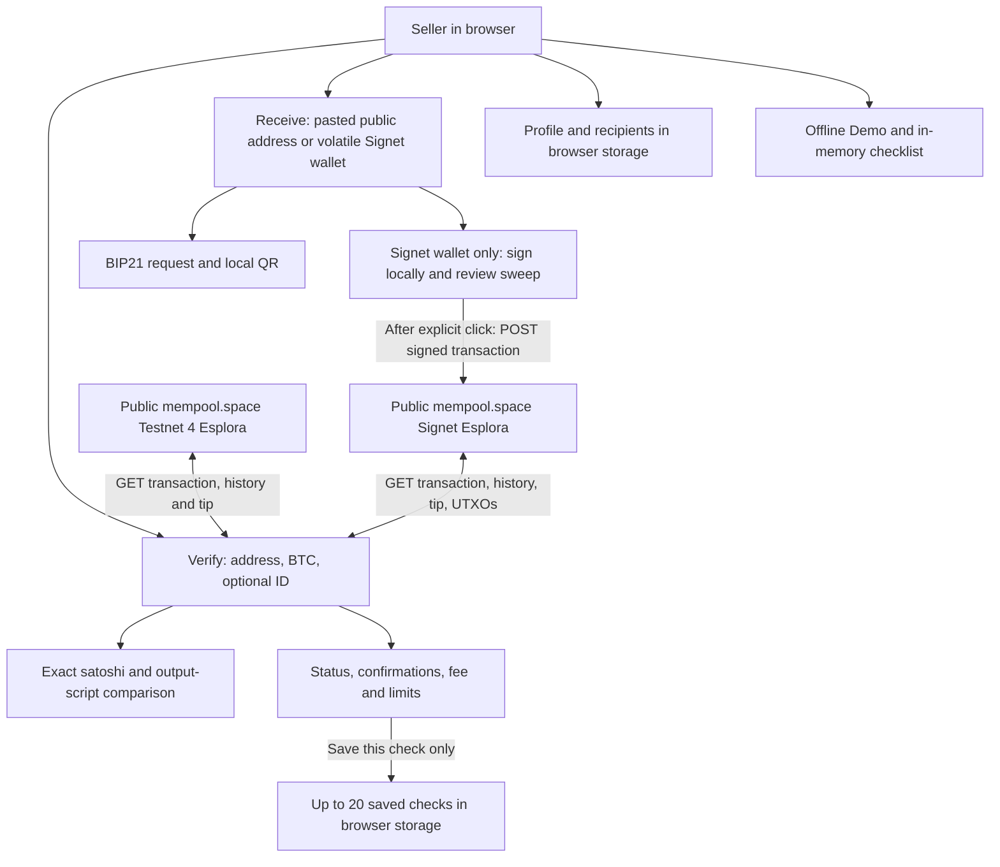

# YOU

**Verify a Bitcoin payment before you release anything.**

A buyer sends a payment screenshot and asks a Lagos freelancer for the final files. A screenshot is not a confirmation. YOU helps freelancers, independent sellers and small businesses check where a Bitcoin payment went and whether it matches the order before they deliver.

**Signet and Testnet 4 only. Do not use real funds.** Demand and usability among Nigerian sellers have not been validated. No interviews, adoption numbers, or testimonials are claimed.

## Features

| Area | What it does |
|---|---|
| **Verify** | Inputs a public receiving address, exact expected BTC, and optional transaction ID. Checks the receiving script, exact sats, and confirmation count. Shows status, transaction fee, fee rate, and detectable explicit RBF signalling. With no ID, it shows only recent address history, not a verified order. |
| **Saved checks** | Save a completed network result only when you choose **Save this check**. Keeps the latest 20 across both test networks, grouped by network. Saving the same query replaces its previous entry. **Recheck** fills the form without sending a request. Copying a result does not save it. |
| **Product tour** | A short YOU intro leads to an interactive first-visit tour. Complete or skip it to stop it from reopening. Open it from Getting started or replay it from About YOU. Verify still has its separate dismissible quick guide. |
| **Receive** | Generates a temporary Signet wallet or uses a pasted Signet/Testnet 4 address. Copies an address or BIP21 request, renders the QR locally, accepts an optional amount and label, and shows recent incoming payments. Sends the request address and optional amount to Verify without checking anything automatically. |
| **Advanced Signet wallet** | Reviews a sweep of the generated wallet’s confirmed outputs (up to 20), signs locally and shows destination, amount and fee. A separate click broadcasts. Watch-only and Testnet 4 never expose broadcast controls. |
| **Send check** | Saves public addresses locally by network, compares full addresses, and flags exact, similar or no match. A hit is not a trust judgement. This screen does not sign or send. |
| **Checklist & Demo** | Eight checks with progress and reset, educational warning signs, and four explicitly simulated offline payment scenarios. Real historical reference transactions are available separately. |
| **Settings** | Open the labelled control at the top right. Getting started, Profile, Appearance, Network preferences, Privacy and security, and About YOU are separate sections. No account. |

## Tour, profile and preferences

Settings puts the guided tour first. About YOU also has **Replay guided tour**. The tour highlights the actual app. Use Back, Next or Skip tour. Escape skips while the tour is open. With reduced motion enabled, YOU goes straight to the welcome screen.

Profile starts in view mode. Choose **Edit Profile** to change the display name or picture, or to return to initials. **Save Profile** saves only the profile. **Cancel** discards the draft. A photo is resized locally and never uploaded. Accepted files: PNG, JPEG or WebP up to 2 MB, with a 16-megapixel decoded limit.

Appearance is always visible separately. Light, Dark and System apply immediately and save without a button. System follows the device. **Save network** applies the default test network and stays separate from Profile. Browser storage is unencrypted and not synced. If it is blocked, a theme or network can apply for this visit without being remembered, and an unsaved profile stays in the editor with an error.

## Run locally or deploy

**Ready to use:** `site/index.html` is a standalone deployment-ready file. Serve the `site` directory over HTTPS or localhost. For a no-build local preview:

```sh
python3 -m http.server 4173 --directory site
```

Use `http://localhost:4173`. An embedded file preview may block network or clipboard access. For source edits and development, install **Node.js 20+** (the deployment workflow uses 22) and run:

```sh
npm ci
npm start
```

**GitHub Pages:** Upload this source (including `.github/`) to a public repo on `main`. Under **Settings > Pages > Source**, select **GitHub Actions** and run **Deploy YOU static site**. The existing workflow builds and checks the standalone artifact before deployment. **Netlify/other static hosting:** build command `npm ci && npm run build`, publish directory `site`, or manually deploy the prebuilt `site/` directory. No backend or environment secrets are needed. Verify your published URL while signed out before adding it to Devpost. This package includes a local preview, not a published repo or permanent public site.

## Architecture

The project keeps its HTML, CSS, JavaScript and esbuild setup. `src/index.html` is the page template and `src/style.css` holds the wine and gold theme. `src/app.js` handles the screens. `src/bitcoin.js` handles Bitcoin validation, exact amounts and signing. `src/saved-checks.js` limits and validates local check records. `src/tour.js` handles the first-visit tour and positioning. `src/profile.js` validates and resizes profile pictures in the browser. `build.mjs` embeds the CSS and bundled JavaScript into one HTML file and computes its CSP script hash. `serve.mjs` is a small local static preview, not an application backend. `tests/` contains unit tests, `scripts/` contains structure/browser/Core tests. Dependencies: `bitcoinjs-lib` for network checks, scripts and PSBT; `@noble/curves` for secp256k1; `qrcode` for local QR rendering; esbuild and Playwright for development only.



### External API dependencies

- **Signet:** `https://mempool.space/signet/api`, including `GET /tx/:id`, `GET /address/:address/txs`, `GET /blocks/tip/height`, and, only for the temporary wallet’s sweep, `GET /address/:address/utxo` and `POST /tx`.
- **Testnet 4:** `https://mempool.space/testnet4/api`, read-only. Testnet 3 and Mainnet are not supported. Signet and Testnet 4 share address encodings; the chosen explorer and payer’s wallet must be set to the same chain.
- Nothing else is fetched by the app. No paid API keys. Demo runs after the file has loaded, even offline. The site does not install an offline cache/service worker. Explorer CORS, limits, and availability can change. Actual HTTPS deploy and availability from Nigerian networks have not been tested.

### Security and privacy

- **Wallet boundary:** The generated private key stays in tab memory, is never exported, logged, or sent to an API, and is lost when the page closes or reloads. No seed input or recovery. Only the locally signed public transaction is sent after explicit broadcast. The optional sweep is for the wallet generated in that tab on Signet; it cannot sign for a pasted watch-only address. No mainnet addresses or endpoints.
- **Validation:** BitcoinJS checks the address encoding/checksum and network. Exact BTC inputs are parsed into integer sats; a transaction ID must be 64 hex characters. The verifier sums outputs to the expected script, checks range and confirmation consistency, and clears stale data on edits or network switches. The full pasted transaction ID, BTC amount and sweep fee rate are validated without truncating them. A missing chain tip is an explorer error, not a missing transaction. Failures never display a pass. Fee rate is fee divided by `ceil(weight/4)`. RBF reports explicit sequence signalling only; “Not detected” does not rule out replacement.
- **Data boundaries:** No analytics, accounts, or backend. The explorer sees your IP and queried public addresses/IDs, plus the signed transaction if broadcast. Saved recipients, display name and preferences stay in this browser. A verification result is stored locally only when you choose **Save this check**. Each entry contains the network, public address, transaction ID if entered, expected sats, result label and check time. Keys are never stored. Browser storage is not encrypted or synced. Clearing browser data removes the records. Optional payment labels are encoded in the shareable request; don’t put private information in them. Browser/system clipboards are outside the app’s control.
- **Defence in depth:** Restrictive script-hash CSP and network allowlist, safe text rendering, checked localStorage reads/writes, explicit broadcast, capped sweep fee rate and request deadlines. A compromised host, browser, extension, or dependency can still access a session key. The prototype depends on one explorer service and is not an independently validating Bitcoin client.

## Known limitations / what remains incomplete

YOU does not support mainnet or Lightning. It cannot identify a recipient, find fraud, verify a bank or naira payment, guarantee finality or reconcile split payments. The wallet has no backup or recovery. Saved checks are snapshots, not an automatically maintained order history. An address-only result or reused address cannot establish that a specific order was paid. History is limited to the explorer’s returned page; activity across all addresses is not tracked. Similarity is a limited visual heuristic (matching six-character ends, or up to seven positional differences in equal-length addresses); no match or exact match gives no assurance of trust. The feedback form is not published. No live production deployment, usability study, security audit, or fresh public Signet fund-and-sweep test is claimed.

## Validation plan and future improvements

1. Share the [short poll and optional form copy](docs/FEEDBACK.md) in Nigerian Bitcoin communities with moderator permission. Ask what people do today; keep raw contact/payment information out of research notes.
2. Invite willing respondents who have accepted Bitcoin directly in Nigeria to try the public Signet example on their usual phones. Compare their current method and YOU on task completion, time to identify a mismatch, and interpretation of confirmations. Use only public examples or test coins. Report actual response counts, tasks observed and limitations; don’t generalize an opt-in sample.
3. Prioritize wording or workflow changes based on observed mistakes. If useful, evaluate independent explorer cross-checks, improved order linkage, and merchant-owned wallet integrations. Persistent keys and real-funds support would require separate design and security review.

## Actual tests and submission material

- [Test report and reproducible commands](docs/TEST-REPORT.md): 14 unit tests, including the 11 existing tests. See the report for Chromium viewport tests, saved-check tests, live Signet and Testnet 4 reads, and the isolated Bitcoin Core sweep.
- [10-step manual testing guide](docs/MANUAL-TEST.md), [three-minute pitch](docs/PITCH.md), and [Devpost description](docs/DEVPOST.md).
- [Official overview](https://dakar-bitcoin-hack-2026.devpost.com/) · [Official rules](https://dakar-bitcoin-hack-2026.devpost.com/rules). Deadline: **20 November 2026, 20:00 UTC / 21:00 WAT**. Add the public repo and accessible MVP or demo URL yourself. See the [MIT license](LICENSE).
